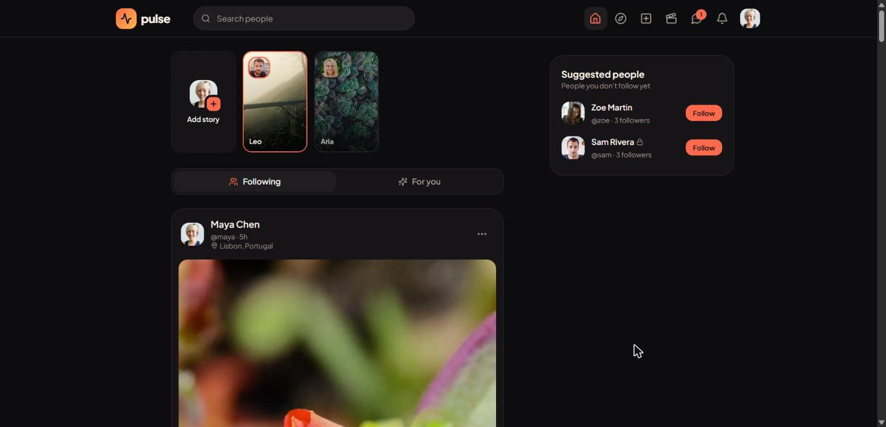
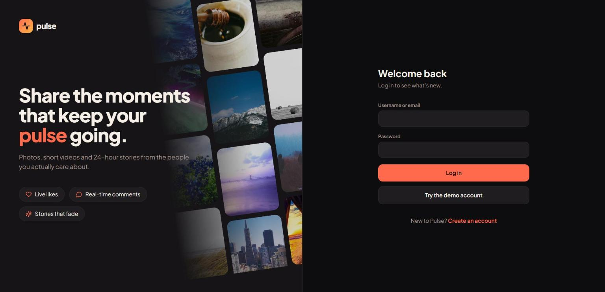
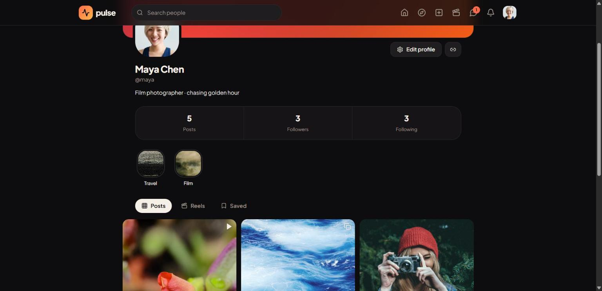
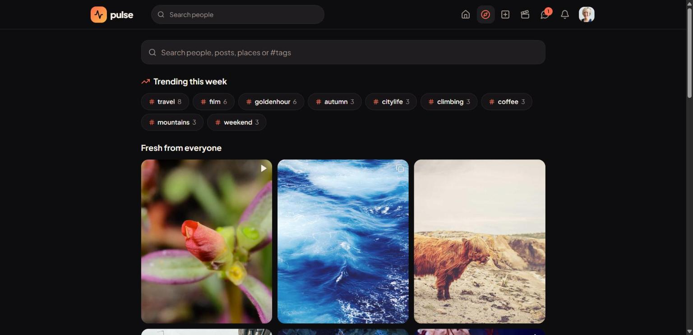
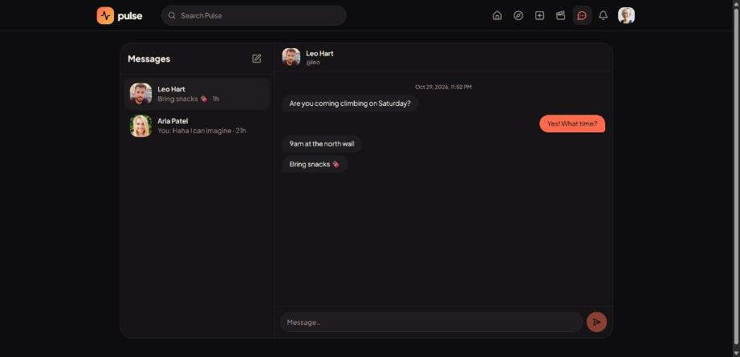
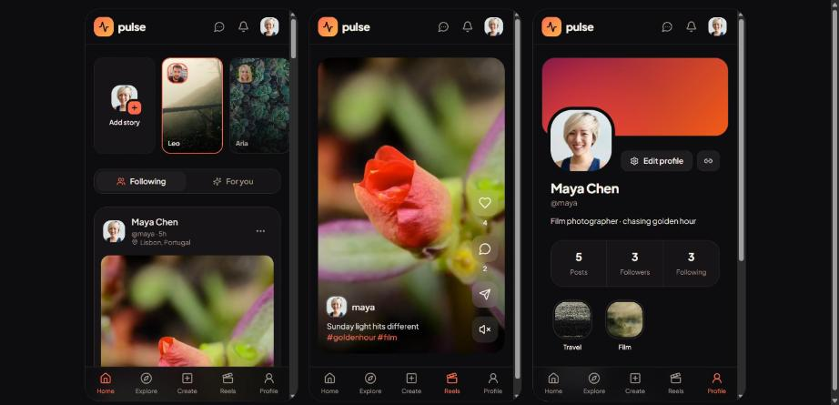

# Pulse

**Pulse is a full-stack social app**: photo, carousel and video posts, reels, 24-hour stories with highlights,
private accounts, threaded comments, hashtags and mentions, real-time chat and notifications, blocking and reporting.

React 19 + Vite + Tailwind CSS on the front end; Node + Express + MongoDB + Socket.io on the back end. It runs locally with **zero setup**: no database to install, and demo data is seeded automatically.



| Login | Profile | Explore |
|---|---|---|
|  |  |  |

| Messages | Mobile (feed · reels · profile) |
|---|---|
|  |  |

---

## Quick start

Requires **Node 22+**.

```bash
npm install      # installs root, server and client (npm workspaces)
npm run dev      # API on http://localhost:4000, web app on http://localhost:5173
```

Open **http://localhost:5173** and click **Try the demo account**.

| Demo user | Password | Notes |
|---|---|---|
| `maya` | `password123` | Main demo account: has highlights, saved posts, two chats (one unread) |
| `leo`, `aria`, `kai`, `zoe` | `password123` | Regular accounts with posts, stories and comments |
| `sam` | `password123` | **Private** account with a pending follow request from `leo` |

**How the database works.** With no `MONGO_URI` set, the API starts an in-memory MongoDB (`mongodb-memory-server`) and re-seeds it on every start. The first run downloads a MongoDB binary (about 600 MB, cached afterwards). Data resets whenever the server restarts.

To use a real database instead:

```bash
cp server/.env.example server/.env   # set MONGO_URI and JWT_SECRET
npm run seed                          # wipes and reseeds that database
npm run dev
```

The demo photos and videos are loaded from public URLs (see [credits](#media-credits)), so the demo needs an internet connection.

## Scripts

| Command | What it does |
|---|---|
| `npm run dev` | Starts the API (auto-restarts on change) and the Vite dev server together |
| `npm test` | API integration tests against an in-memory MongoDB (`node:test`) |
| `npm run seed` | Re-seeds a real database (only with `MONGO_URI`) |
| `npm run bench -w server` | Load-tests the feed endpoints with autocannon (start the API first) |
| `npm run build -w client` | Production build of the web app |

## Features

| Area | What you can do |
|---|---|
| **Posts** | Up to 10 photos in a swipeable carousel, or one video; caption with `#tags` and `@mentions`; optional location; edit caption; delete; copy link; report |
| **Feeds** | **Following**: chronological, cursor-paginated infinite scroll. **For you**: ranked by engagement and recency |
| **Explore** | Trending hashtags, a grid of everyone's recent posts, and search across people, posts and places, and tags |
| **Reels** | Full-height, scroll-snap video feed that autoplays the reel on screen |
| **Engagement** | Like, comment, reply (one level), like comments, save; counts update live on every open screen |
| **Social graph** | Follow and unfollow, private accounts with follow requests, followers/following/likes lists, suggested people |
| **Stories** | 24-hour image stories (MongoDB TTL index), seen/unseen rings, viewer list, replies that arrive as DMs, profile highlights |
| **Messages** | Real-time 1:1 chat with unread badges, typing indicator, "Seen" receipts, and loading older messages |
| **Notifications** | Live over Socket.io: likes, comments, replies, mentions, comment likes, follows, requests, accepted requests |
| **Safety** | Block (hides both people from each other everywhere and removes follows), report posts with a reason |
| **Account** | Edit avatar, name and bio; private toggle; blocked list; change password; delete account (cleans up everything) |
| **Media** | Photos are resized to ≤1600px WebP in the browser before upload (native canvas, no library) |

## Tech stack

| Layer | Choices |
|---|---|
| Front end | React 19, Vite 6, React Router 7, Tailwind CSS 4, lucide-react, socket.io-client. Auth state in React Context; no Redux |
| Back end | Node 22, Express 5, Mongoose 8, Socket.io 4, JWT (`jsonwebtoken`) + `bcryptjs`, multer for uploads |
| Database | MongoDB, with `mongodb-memory-server` when no `MONGO_URI` is set |
| Tooling | npm workspaces, `concurrently`, `node:test`, autocannon |

## Project structure

```
pulse/
├─ package.json              npm workspaces; "dev" runs API + web together
├─ server/
│  ├─ src/
│  │  ├─ index.js            connect DB → seed (in-memory mode) → listen
│  │  ├─ app.js              Express app: middleware order and route mounting
│  │  ├─ db.js               MONGO_URI or in-memory MongoDB
│  │  ├─ models.js           all Mongoose schemas and indexes
│  │  ├─ access.js           every privacy + blocking rule in one place
│  │  ├─ cache.js            TTL cache (the local stand-in for Redis)
│  │  ├─ socket.js           JWT-authenticated Socket.io, private rooms, notify()
│  │  ├─ lib.js              auth middleware, uploads, rate limit, errors, caption parsing
│  │  ├─ deleteAccount.js    removes a user and fixes the counters they contributed to
│  │  ├─ seed.js             demo data
│  │  └─ routes/             auth · users · social · posts · comments · stories · messages · notifications
│  ├─ test/api.test.js       integration tests
│  ├─ bench.js               autocannon load test
│  └─ uploads/               uploaded media, served at /uploads
└─ client/src/
   ├─ api.js  hooks.js       fetch wrapper; useFetch / usePaged / useOnline
   ├─ auth.jsx  toast.jsx    session, live socket and badge counts; toasts
   ├─ compress.js            in-browser image compression
   ├─ components/            PostCard, Comments, Stories, Layout, Modal, UserList, Ui, …
   └─ pages/                 Home, Explore, Reels, Create, Profile, PostPage, TagPage, Messages, Notifications, Settings, Auth
```

## Architecture

```
Browser ──REST /api──────────▶ Express ──▶ MongoDB
   │     ◀─ /uploads (static) ──┤
   └──── Socket.io (JWT) ◀─────▶ per-user rooms "user:<id>"
```

In development, Vite proxies `/api`, `/uploads` and `/socket.io` to the API, so the client only ever calls relative URLs.

**Request pipeline** (`app.js`): JSON body → static `/uploads` → write rate limit (120 writes/min per IP) → public auth routes → JWT `auth` → feature routes → `{ "error": "message" }` error handler.

**Key design decisions**

- **One privacy layer.** `access.js` decides who can see what: blocked either way, private and not followed, and so on. Every route calls it, and anything hidden returns `404`, so private content never leaks through a different status code.
- **One query for every post list.** `findPosts()` is a single aggregation that every list goes through (feed, explore, reels, tags, profile, saved, search). See [Interview notes](#interview-notes).
- **Denormalised counters.** `likeCount`, `commentCount`, `followerCount` and the per-user unread message counts live on the documents and are updated with atomic `$inc`. Compound unique indexes (`{ postId, userId }` and similar) make double-likes and double-follows impossible.
- **Real-time over rooms.** Every socket authenticates with the same JWT and joins `user:<id>`. Notifications, messages, read receipts and typing go only to the people involved. Like and comment *counts* are broadcast to everyone, but they contain only ids and numbers, never comment text.
- **Optimistic UI.** Likes, saves, follows and comment likes flip instantly, then take the server's answer, or roll back with an error toast.
- **Native platform first.** `<dialog>` for modals, `<details>` for menus, a `popover` for toasts, CSS scroll-snap for reels and carousels, a CSS animation's `animationend` for story auto-advance, `IntersectionObserver` for infinite scroll and autoplay, and `<canvas>` for image compression.

### Data model

| Collection | Key fields | Indexes |
|---|---|---|
| `User` | name, username, email, passwordHash, avatarUrl, bio, isPrivate, followerCount, followingCount | unique username, unique email |
| `Follow` | followerId, followingId | unique `{followerId, followingId}` |
| `FollowRequest` | fromId, toId | unique `{fromId, toId}`, toId |
| `Block` | blockerId, blockedId | unique `{blockerId, blockedId}` |
| `Post` | authorId, caption, mediaUrl, mediaType, extraMedia[], location, tags[], likeCount, commentCount, editedAt, createdAt | authorId, tags, createdAt |
| `Like` / `Save` | postId, userId | unique `{postId, userId}` |
| `Comment` | postId, userId, parentId, body, likeCount | postId |
| `CommentLike` | commentId, userId | unique `{commentId, userId}` |
| `Story` | authorId, mediaUrl, createdAt | **TTL 24h** on createdAt |
| `StoryView` | storyId, viewerId | unique pair, TTL 24h |
| `Highlight` | authorId, title, items[] | authorId |
| `Conversation` | key, members[], lastMessage, unread{userId: n}, readAt{userId: date} | unique key |
| `Message` | conversationId, senderId, body, storyMediaUrl | conversationId |
| `Notification` | userId, type, actorId, postId, isRead | userId |
| `Report` | reporterId, postId, reason | unique `{reporterId, postId}` |

Follow requests are a separate collection rather than a `status` field on `Follow`. That keeps every feed and follower query a plain lookup, with no `status: 'accepted'` filter to forget.

## Interview notes

**Fan-out on write or fan-out on read? Which did you build, and why?**
Fan-out on write copies each new post id into every follower's feed. Reads are cheap, but one post costs one write per follower, and follows, unfollows, blocks and deletes all need backfill and cleanup. **Pulse uses fan-out on read**: at request time it looks up who I follow and runs `Post.find({ authorId: { $in: [...following, me] } }).sort({ createdAt: -1 })` against the `authorId` and `createdAt` indexes. That's one query, no extra collection, and every graph change shows up immediately.

**A user with 1 million followers posts. What breaks?**
With fan-out on write, that's 1M inserts per post: queues back up and feeds lag. With fan-out on read, nothing happens at post time, but users who follow thousands of accounts run a big `$in`. Real systems go hybrid: fan-out on write for normal accounts, and celebrity posts pulled and merged at read time. Pulse's per-user cache of the ranked feed already keeps repeated reads cheap.

**Why cursor pagination instead of page numbers?**
New posts keep arriving at the top. With `?page=2` everything shifts, so you get duplicates or skipped posts, and `skip()` gets slower the deeper you go. A cursor (`createdAt < last seen`) is stable and walks the index directly. The ranked feed pages by offset, but into a cached snapshot of the ranking, so it's stable too.

**Walk me through the `$lookup` aggregation. What does it cost?**
`findPosts()` (in `routes/posts.js`) runs `$match → $sort → $limit` first, then `$lookup` for the author, `$lookup` for "did I like it" and `$lookup` for "did I save it". The last two hit the `{ postId, userId }` unique indexes with `$limit: 1`. Because `$limit` comes before the lookups, a page costs one index scan plus at most 3 × 20 point lookups. Putting `$lookup` before `$limit` would join every matching post, and that's the mistake to avoid.

**Why store `likeCount` on the post instead of counting likes?**
Reads vastly outnumber writes. Counting on every render is one `countDocuments` per post per viewer; storing the count is one atomic `$inc` per like. The unique index keeps it honest.

**How does "For you" rank posts?**
`score = (likes + 2 × comments + 1) / (ageHours + 2)^1.5`, computed in an aggregation over the last 14 days of posts from people you follow. It's the Hacker News idea: engagement pushes a post up, and age pulls it down.

**What did you cache, with what TTL, and how do you invalidate it?**

| Key | TTL | Invalidated when |
|---|---|---|
| `following:<userId>` | 60 s | That user follows, unfollows, has a request accepted, blocks or is blocked |
| `ranked:<userId>` | 2 min | Someone they follow posts (the *invalidation* fans out to followers), or their follows change |
| `trending` | 5 min | Never; trending tags may be a few minutes old |

Locally the cache is an in-process `Map` (`cache.js`). In production it would become Redis with the same keys and TTLs, so every API instance shares it, and the Socket.io Redis adapter would carry events between instances.

**Benchmark.** `npm run bench -w server`, one local run, 20 connections, in-memory MongoDB:

| Endpoint | req/s | p50 | p97.5 |
|---|---|---|---|
| `/api/feed` | 676 | 28 ms | 42 ms |
| `/api/feed?sort=ranked` | 766 | 25 ms | 32 ms |
| `/api/explore` | 540 | 36 ms | 44 ms |
| `/api/explore/trending` | 1658 | 11 ms | 18 ms |

To compare without the cache, restart the API with `NO_CACHE=1` (bash: `NO_CACHE=1 npm run dev`; PowerShell: `$env:NO_CACHE=1; npm run dev`) and run the bench again.

## API reference

All routes live under `/api`, use JSON, and require `Authorization: Bearer <token>` except register and login.
Lists default to 10 items with a hard maximum of 20. `nextCursor` is `null` on the last page.
Errors always look like `{ "error": "message" }`: `400` validation, `401` not logged in, `403` not allowed, `404` not found (also used for private or blocked content), `409` duplicate, `429` rate limited.

| Method | Path | Description |
|---|---|---|
| POST | `/auth/register` | `{ name, username, email, password }` → `{ token, user }` |
| POST | `/auth/login` | `{ login, password }` (login = username or email) → `{ token, user }` |
| GET | `/auth/me` | Current user |
| GET | `/users/:username` | `{ user, followStatus, blockedByMe, isLocked, posts, highlights }` |
| PATCH | `/users/me` | multipart or JSON: `name`, `bio`, `avatar`, `isPrivate` |
| PATCH | `/users/me/password` | `{ currentPassword, newPassword }` |
| DELETE | `/users/me` | `{ password }`; deletes the account and all of its data |
| GET | `/users/suggestions` | Up to 6 people I don't follow |
| GET | `/search?q=&type=user\|post\|hashtag` | People (name/username), posts (caption/location) or hashtags (prefix, with counts) |
| POST | `/users/:id/follow` | Toggle → `{ status: following \| requested \| none, followerCount }` |
| DELETE | `/users/:id/follower` | Remove one of my followers |
| GET | `/users/:id/followers` · `/users/:id/following` | Lists with `followStatus` per user |
| GET | `/follow-requests` | Requests to my private account |
| POST | `/follow-requests/:id/accept` · `/decline` | Respond to a request |
| POST | `/users/:id/block` | Toggle → `{ blocked }` |
| GET | `/blocks` | People I've blocked |
| GET | `/feed?cursor=&limit=` | Following feed: me + people I follow, newest first |
| GET | `/feed?sort=ranked&cursor=&limit=` | "For you" feed (cursor = offset into the cached ranking) |
| GET | `/explore?cursor=&limit=` | Everyone's posts, minus private and blocked accounts |
| GET | `/reels?cursor=&limit=` | Video posts |
| GET | `/tags/:tag?cursor=&limit=` | Posts with a hashtag |
| GET | `/explore/trending` | Top 10 hashtags of the last 7 days |
| GET | `/saved` | My saved posts |
| POST | `/posts` | multipart: `media` (≤10 images or 1 video, ≤50 MB each), `caption`, `location` |
| GET · PATCH · DELETE | `/posts/:id` | Read · edit caption/location · delete (own posts only) |
| POST | `/posts/:id/like` | Toggle → `{ liked, likeCount }` |
| GET | `/posts/:id/likes` | Who liked a post |
| POST | `/posts/:id/save` | Toggle → `{ saved }` |
| POST | `/posts/:id/report` | `{ reason: spam \| inappropriate \| harassment \| other }` |
| GET | `/posts/:id/comments` | Flat list with `parentId`, `likeCount`, `likedByMe` |
| POST | `/posts/:id/comments` | `{ body, parentId? }` → `{ comment, commentCount }` |
| DELETE | `/comments/:id` | Deletes a comment and its replies → `{ removedIds, commentCount }` |
| POST | `/comments/:id/like` | Toggle → `{ liked, likeCount }` |
| GET · POST | `/stories` | Grouped by author with `viewed` flags · upload `media` (image) |
| POST | `/stories/:id/view` | Mark a story as seen |
| GET | `/stories/:id/viewers` | Who saw my story |
| POST | `/stories/:id/reply` | `{ body }`; arrives as a DM with the story thumbnail |
| GET · POST | `/highlights` | My highlights · create `{ title, storyId }` |
| POST | `/highlights/:id/items` | Add a story `{ storyId }` |
| DELETE | `/highlights/:id` | Delete a highlight |
| GET | `/conversations` | Inbox → `{ conversations, unreadMessages }` |
| POST | `/conversations` | `{ userId }` → find or create a chat |
| GET | `/conversations/:id/messages?before=` | 30 messages; older ones with `before` |
| POST | `/conversations/:id/messages` | `{ body }` |
| PATCH | `/conversations/:id/read` | Mark read → `{ unreadMessages }` |
| GET | `/notifications?cursor=` | 20 per page → `{ notifications, nextCursor, unreadCount }` |
| PATCH | `/notifications/read-all` | Mark all read |
| GET | `/counts` | Badge numbers `{ notifications, messages, requests }` |

**Socket.io events.** Server → client: `notification:new`, `message:new`, `conversation:read`, `typing`, `post:liked`, `comment:new`, `comment:deleted`. Client → server: `typing { conversationId }`.

### Try it with curl

```bash
B=http://localhost:4000/api
TOKEN=$(curl -s -X POST $B/auth/login -H 'Content-Type: application/json' \
  -d '{"login":"maya","password":"password123"}' | node -pe 'JSON.parse(require("fs").readFileSync(0)).token')
H="Authorization: Bearer $TOKEN"

curl -s "$B/feed?limit=2" -H "$H"
curl -s "$B/feed?sort=ranked&limit=2" -H "$H"
curl -s -X POST $B/posts -H "$H" -F caption="sunset #travel with @leo" -F location="Lisbon" -F media=@a.jpg -F media=@b.jpg
curl -s -X POST $B/posts/<postId>/comments -H "$H" -H 'Content-Type: application/json' -d '{"body":"nice","parentId":"<commentId>"}'
curl -s "$B/search?type=hashtag&q=tr" -H "$H"
curl -s -X POST $B/conversations -H "$H" -H 'Content-Type: application/json' -d '{"userId":"<userId>"}'
curl -s $B/counts -H "$H"
```

## Demo script (two browser windows)

Open a normal window as **maya** and a private/incognito window as **leo**. Incognito has separate storage, so it's a separate session. Put them side by side.

1. **Live counts and notifications.** As leo, like one of maya's posts and comment `@maya nice!`. In maya's window, the post's like and comment counts change in place, the bell badge goes up, and toasts appear. Nobody refreshes.
2. **Messages.** Maya opens **Messages → Leo**. As leo, start typing: maya sees *typing…*, then the message arrives instantly. Maya replies; when leo opens the chat, maya sees **Seen**.
3. **Stories.** As maya, open Leo's story and reply to it; the reply lands in Leo's messages with the story thumbnail. As leo, open your own story → **Viewers** lists maya.
4. **Private accounts.** As maya, open `/u/sam`: the profile is locked. Click **Follow** (it changes to *Requested*). Log in as sam → **Notifications → Follow requests → Confirm**. Maya's view of sam unlocks.
5. **For you vs Following.** Switch tabs on Home. *For you* puts the most-engaged recent posts first; *Following* is newest first.
6. **Blocking.** On any profile, open **⋯ → Block**. That person's posts, stories, comments and messages disappear for both sides.

## Quality checks

What's verified, and how to re-run it:

| Check | How | Result |
|---|---|---|
| API behaviour | `npm test` covers auth, feed paging and the 20-item cap, likes, comments and replies, private accounts, blocking, DMs, ranked feed, search, cache invalidation | 4/4 passing |
| Production build | `npm run build -w client` | Builds clean |
| Runtime errors | Every route opened in the browser, including the 404 page and a bad post id | No console errors |
| Accessibility | Every button and link has an accessible name; images have `alt`; inputs have labels; one visible focus ring everywhere; native `<dialog>` handles focus trapping and Escape | Checked on all main pages |
| Touch and motion | Icon buttons are 44 px on touch screens; all motion is 150–320 ms with ease-out; `prefers-reduced-motion` turns off decorative motion | — |
| Load | `npm run bench -w server` | See [benchmark](#interview-notes) |

## UI design notes

- **Theme.** Dark warm-black surfaces with a single coral accent (`#ff6a4d`), used only for actions, active states and unread markers. Amber marks saved items and mentions. One typeface (Plus Jakarta Sans) in multiple weights.
- **Shapes.** Rounded "squircle" avatars and story *cards* (not circles) set Pulse apart from Instagram. Media sits inset inside cards with its own radius.
- **Layout.** Desktop: top navbar with search, a centred feed column and a sticky "Suggested people" panel. Mobile: a compact top bar plus a bottom tab bar (Home, Explore, Create, Reels, Profile).
- **States.** Every async view has a skeleton, an empty state that says what to do next, and an error state with **Try again**. An offline banner appears when the connection drops, broken images fall back to a placeholder, and toasts replace `alert()`.
- **Motion.** Purposeful only: dialog fade-and-lift, toast slide-in, a heart "pop" on like, press feedback on buttons, and a CSS-timed story progress bar.

## Known limits and next steps

- **Single instance.** The cache, rate limiter and Socket.io rooms live in one process. Add Redis (cache + `@socket.io/redis-adapter`) to run several.
- **Media storage.** Media is stored on local disk. Cloudinary or S3 with a CDN, plus responsive `srcset`, is the production path. Expired stories leave their files on disk, because highlights may still use them.
- **Not built yet:** group chats, media in messages, video stories, automated moderation, a background worker (BullMQ) for notification fan-out and digests, and deployment config.
- Deliberate shortcuts are marked in the code with `ponytail:` comments: regex search, capped profile grids and follower lists, and global count broadcasts.

## Media credits

Seed photos come from [picsum.photos](https://picsum.photos) (Unsplash licence) and portraits from [randomuser.me](https://randomuser.me).
Video clips are MDN's CC0 samples and clips from [test-videos.co.uk](https://test-videos.co.uk) (Blender Foundation, CC BY 3.0).
